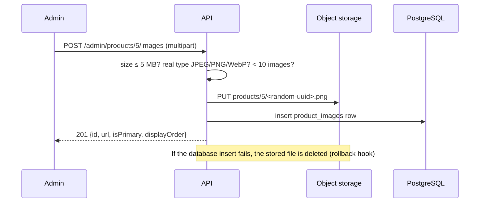
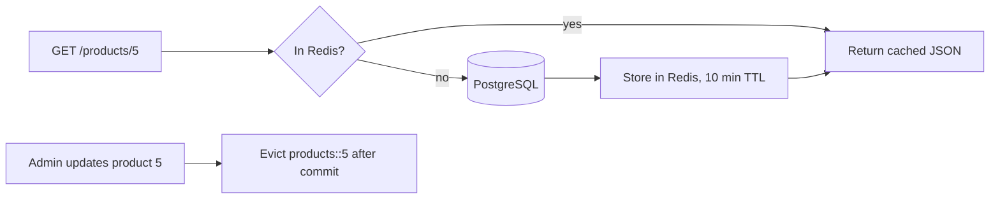

# Catalog

Categories, products, search, image uploads and Redis caching.

- [Endpoints](#endpoints)
- [Searching products](#searching-products)
- [Categories](#categories)
- [Product images](#product-images)
- [Caching](#caching)
- [Performance](#performance)
- [Design decisions](#design-decisions)
- [Configuration](#configuration)
- [Try it locally](#try-it-locally)
- [Tests](#tests)

## Endpoints

**Public** (no account needed):

| Method | Path | Notes |
|---|---|---|
| `GET` | `/api/v1/categories` | All categories as a flat list with `parentId`; the client builds the tree. Cached. |
| `GET` | `/api/v1/products` | Search, filter, sort and paginate active products. |
| `GET` | `/api/v1/products/{id}` | Full product with images. Cached. `404` if archived. |

**Admin** (`ADMIN` role; protected by a `/api/v1/admin/**` rule and `@PreAuthorize` on each controller):

| Method | Path | Notes |
|---|---|---|
| `POST` | `/api/v1/admin/categories` | Create, optionally under a parent |
| `PUT` | `/api/v1/admin/categories/{id}` | Rename or move |
| `DELETE` | `/api/v1/admin/categories/{id}` | `409` if it still has subcategories or products |
| `GET` | `/api/v1/admin/products` | Same search as public, plus `active=true/false` (omit for both) |
| `GET` | `/api/v1/admin/products/{id}` | Includes archived products |
| `POST` | `/api/v1/admin/products` | Create; `active` defaults to `true` |
| `PUT` | `/api/v1/admin/products/{id}` | Full update |
| `DELETE` | `/api/v1/admin/products/{id}` | **Archive** (`active=false`), not a hard delete |
| `POST` | `/api/v1/admin/products/{id}/images` | Multipart upload, field name `file` |
| `DELETE` | `/api/v1/admin/products/{id}/images/{imageId}` | Removes the row and the stored file |

## Searching products

```http
GET /api/v1/products?search=laptop&categoryId=1&minPrice=100&maxPrice=1500&sort=price,asc&page=0&size=20
```

| Parameter | Behavior |
|---|---|
| `search` | Case-insensitive match on name **or** description. `%` and `_` are escaped, so `50%` means the literal text. |
| `categoryId` | Includes **all subcategories**: `Electronics` also returns products in `Laptops`. |
| `minPrice`, `maxPrice` | Inclusive. `minPrice > maxPrice` is a `400`. |
| `sort` | `createdAt` (default, newest first), `name` or `price`, with `,asc` or `,desc`. Any other field is a `400`, so clients cannot sort by internal columns. |
| `page`, `size` | Zero-based page; `size` defaults to 20 and is capped at 100. |

Filters are built with JPA **Specifications**: each filter is a small, independent piece, and only the ones present in the request are combined with `AND`. Values are bound as query parameters, never concatenated into SQL.

```java
public static Specification<Product> matching(String search, Collection<Long> categoryIds,
                                              BigDecimal minPrice, BigDecimal maxPrice, Boolean active) {
    List<Specification<Product>> filters = new ArrayList<>();
    if (active != null) filters.add(hasActive(active));
    if (StringUtils.hasText(search)) filters.add(nameOrDescriptionContains(search));
    if (categoryIds != null) filters.add(categoryIn(categoryIds));
    if (minPrice != null) filters.add(priceAtLeast(minPrice));
    if (maxPrice != null) filters.add(priceAtMost(maxPrice));
    return Specification.allOf(filters);
}
```

Every sort gets `id` appended as a tie-breaker, so products with the same price never jump between pages.

**Response** (`PageResponse<ProductSummaryResponse>`):

```json
{
  "content": [
    {
      "id": 1,
      "name": "ProBook 14 Laptop",
      "price": 899.99,
      "stock": 25,
      "active": true,
      "thumbnailUrl": "https://picsum.photos/seed/probook14/600/600",
      "categoryName": "Laptops"
    }
  ],
  "page": 0,
  "size": 20,
  "totalElements": 1,
  "totalPages": 1
}
```

## Categories

Categories form a tree through an optional `parentId`. The service enforces three rules:

| Rule | Response |
|---|---|
| Sibling names are unique (case-insensitive). The same name under different parents is fine. | `409` (also enforced by a unique index) |
| A category cannot become its own parent, or a child of one of its own subcategories (that would create a loop). | `400` |
| A category with subcategories or products (including archived ones) cannot be deleted. | `409` |

## Product images

Images are stored in **S3-compatible object storage**; the database keeps only the URL and the storage key. Locally this is [RustFS](https://github.com/rustfs/rustfs) in Docker Compose; in production the same code works with Amazon S3, Cloudflare R2 or any S3-compatible service by changing configuration.



**Upload rules**

- The type is detected from the file's **first bytes** (its "magic number"), not from the file name or the client's `Content-Type`. An `.exe` renamed to `cat.jpg` is rejected.
- Only JPEG, PNG and WebP (no SVG, which can contain scripts); 5 MB per file; 10 images per product.
- Files are stored under a random key (`products/{productId}/{uuid}.{ext}`). The client's file name is never used, so path tricks like `../../etc/passwd.png` have no effect.
- The first image becomes the **primary** (thumbnail). Deleting the primary promotes the next image.
- Stored files are served with `Cache-Control: public, max-age=31536000, immutable`; a key never changes content.

**Keeping storage and database consistent**

```java
// The file is stored before the database row exists; if the transaction fails, remove the orphaned file.
TransactionSynchronizationManager.registerSynchronization(new TransactionSynchronization() {
    @Override
    public void afterCompletion(int status) {
        if (status == STATUS_ROLLED_BACK) {
            storage.delete(key);
        }
    }
});
```

Deletes work the other way round: the row is removed first, and the file is deleted only **after commit**, so a rolled-back delete never leaves a product pointing at a missing image.

## Caching

Product details and the category list are cached in Redis using Spring's cache abstraction.



```java
@Cacheable(cacheNames = CacheNames.PRODUCTS, key = "#id")
@Transactional(readOnly = true)
public ProductResponse getActiveProduct(Long id) { ... }

@CacheEvict(cacheNames = CacheNames.PRODUCTS, key = "#id")
@Transactional
public ProductResponse update(Long id, ProductUpdateRequest request) { ... }
```

| Cache | Key | Evicted when |
|---|---|---|
| `products` | product id | the product is updated, archived, or its images change; **all** entries when a category is renamed (cached products contain the category name) |
| `categories` | `all` | any category is created, updated or deleted |

**Details that matter**

- The cache stores **DTOs as JSON**, never JPA entities. Each cache has a **typed** serializer (`ProductResponse`, `List<CategoryResponse>`), so no Java class names are written to Redis, and records deserialize correctly.
- Evictions are **transaction-aware**: they run after the database commit, so a concurrent request cannot re-cache the old value in between.
- Entries expire after 10 minutes as a safety net.
- **Redis is optional at runtime.** If it is down, cache errors are logged and requests are served from PostgreSQL. Redis timeouts are set to 2 seconds so an outage fails over quickly.
- Search results are deliberately **not** cached: every filter combination would be a separate entry, and keeping them all correct after an edit is not worth it at this scale.

## Performance

A listing page needs each product's category name and thumbnail, both lazy associations. Without care that is the classic **N+1 problem** (1 query for the page + 1 per product for the category + 1 per product for images = 41 queries for 20 products).

`hibernate.default_batch_fetch_size=50` makes Hibernate load all categories, then all images, for the whole page in one query each:

| Query | Purpose |
|---|---|
| 1 | page of products |
| 2 | count (skipped when the first page is not full) |
| 3 | categories for those products (`WHERE id IN (...)`) |
| 4 | images for those products (`WHERE product_id IN (...)`) |

Measured on the seed data: **3 SQL statements** for a full listing response. Repeated product detail requests run **0** statements (served from Redis).

## Design decisions

| Decision | Why |
|---|---|
| Archive instead of delete | Past orders reference products; deleting would break order history. |
| AWS SDK with a configurable endpoint | One implementation for local RustFS, Amazon S3 and Cloudflare R2. |
| Storage version pinned (`rustfs/rustfs:1.0.4`) | MinIO stopped publishing images; pinning prevents a silent breaking change on the next `docker compose pull`. |
| SDK checksums only `WHEN_REQUIRED` | Recent AWS SDK versions add checksum headers that some S3-compatible servers reject. |
| Strict MapStruct (`unmappedTargetPolicy=ERROR`) | A field added to a DTO but forgotten in a mapper fails the build instead of silently returning `null`. |
| `active` is optional on create, required on update | Jackson 3 rejects a missing value for a primitive `boolean`; create defaults to `true`, and `PUT` (a full replace) asks for it explicitly with a clear validation error. |

## Error responses

All errors use the standard format described in [Authentication](authentication.md#error-responses).

| Status | Catalog examples |
|---|---|
| `400` | Unknown sort field, `minPrice > maxPrice`, invalid body, wrong JSON type (`"Invalid or missing value for 'price'"`), not an allowed image type, category loop |
| `401` / `403` | Admin endpoint without a token / as a customer |
| `404` | Unknown or archived product (public), unknown category or image |
| `409` | Duplicate sibling category name, deleting a non-empty category, 11th image |
| `413` | File larger than 5 MB |
| `415` | Upload sent without `multipart/form-data` |

## Configuration

| Property | Default | Notes |
|---|---|---|
| `app.storage.endpoint` | `${STORAGE_ENDPOINT:}` | Leave empty for Amazon S3; set for RustFS, R2, etc. |
| `app.storage.region` | `${STORAGE_REGION:us-east-1}` | |
| `app.storage.access-key` / `secret-key` | `${STORAGE_ACCESS_KEY:}` / `${STORAGE_SECRET_KEY:}` | If empty, the AWS default credential chain is used (e.g. an IAM role). |
| `app.storage.bucket` | `${STORAGE_BUCKET:product-images}` | |
| `app.storage.public-url` | `${STORAGE_PUBLIC_URL}` | Base URL for image links, e.g. a CDN in front of the bucket. |
| `app.storage.create-bucket` | `false` | `true` in `dev`: creates the bucket with public read access on startup. |
| `app.cache.ttl` | `10m` | |
| `hibernate.default_batch_fetch_size` | `50` | Prevents N+1 queries on listings. |
| `spring.data.web.pageable.max-page-size` | `100` | |
| `spring.servlet.multipart.max-file-size` | `5MB` | |

## Try it locally

1. `docker compose up -d` (now also starts RustFS on ports 9000/9001).
2. Run the app with the `dev` profile. On first start it logs `Created storage bucket 'product-images' with public read access`.
3. In Swagger UI (<http://localhost:3330/swagger-ui.html>):
   - Browse `GET /api/v1/products` with different filters, e.g. `categoryId=1` (Electronics includes Laptops).
   - Log in as `admin@example.com` / `Admin@123`, click **Authorize**, then use the **Admin: Products** endpoints.
   - `POST /api/v1/admin/products/{id}/images` shows a file picker; upload a JPEG or PNG and open the returned `url`.
4. Browse uploaded files in the RustFS console at <http://localhost:9001/rustfs/console/> (user `ecommerce`, password `ecommerce-secret`).
5. Watch the cache: `docker exec ecommerce-redis redis-cli --scan --pattern 'ecommerce::*'`.

## Tests

| Test class | Covers |
|---|---|
| `ImageTypeTest` | JPEG/PNG/WebP detection; rejects GIF, `.exe`, `.wav` (also RIFF), SVG, empty and truncated input |
| `CategoryServiceTest` | Own-parent and loop prevention, sibling-name uniqueness, delete blocked by subcategories or products, subtree resolution |
| `ProductServiceTest` | Sort-field whitelist, price-range check, stable tie-breaker sort, archived products return 404, unknown category on create, archive keeps the row |
| `ProductImageServiceTest` | Random storage keys (client file name ignored), first image primary, display order, fake image rejected before storage is touched, 10-image limit, file removed on rollback, primary promotion, file deleted only after commit |

```bash
mvnw.cmd test -Dtest=ImageTypeTest,CategoryServiceTest,ProductServiceTest,ProductImageServiceTest
```
