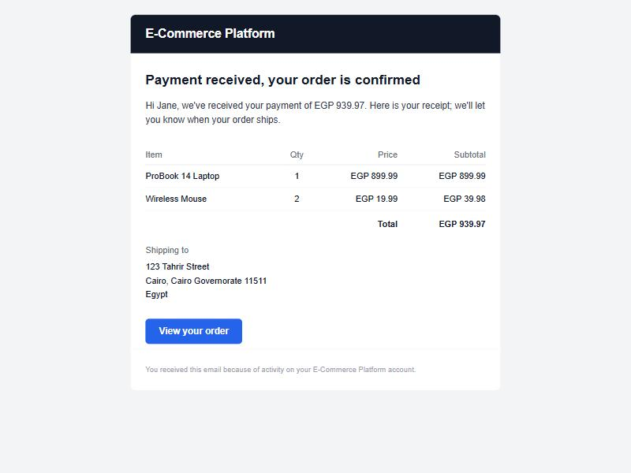
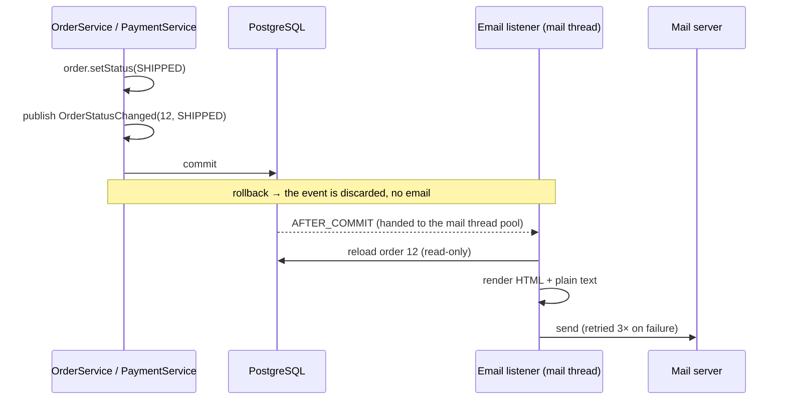

# Emails

Order and account emails, sent only after the database commits, in the background, with retries.



- [Which emails are sent](#which-emails-are-sent)
- [How it works](#how-it-works)
- [Guarantees](#guarantees)
- [Templates](#templates)
- [Delivery and retries](#delivery-and-retries)
- [Configuration](#configuration)
- [Try it locally](#try-it-locally)
- [How it was tested](#how-it-was-tested)

## Which emails are sent

| Trigger | Recipient | Subject |
|---|---|---|
| Checkout (`PENDING`) | Customer | Order #12 received: complete your payment |
| Payment confirmed (`PAID`) | Customer | Payment received for order #12 (a full receipt) |
| `SHIPPED` | Customer | Your order #12 is on its way |
| `DELIVERED` | Customer | Your order #12 was delivered |
| `CANCELLED` | Customer | Your order #12 was cancelled, with the reason: by the customer, by the store, or payment window expired |
| `PROCESSING` | | None (an internal step) |
| Payment needs review (amount mismatch, or money received for a closed order) | Store admin | Action needed: payment #5 for order #12 |
| Forgot password | Customer | Reset your password (one-time link) |

## How it works

Services never send email. They publish a **domain event** describing what happened, and a listener reacts **after the transaction commits**:



```java
@Async(AsyncConfig.MAIL_EXECUTOR)
@TransactionalEventListener(phase = TransactionPhase.AFTER_COMMIT)
public void onOrderStatusChanged(OrderStatusChanged event) {
    try {
        orderEmails.forStatusChange(event).ifPresent(emailSender::send);
    } catch (RuntimeException e) {
        log.error("Could not send the {} email for order {}; the order itself is unaffected", ...);
    }
}
```

| Event | Published by | Listener |
|---|---|---|
| `OrderStatusChanged(orderId, status, cancellationReason)` | `OrderService`, `PaymentService` | `OrderEmailListener` |
| `PaymentNeedsReview(paymentId)` | `PaymentService` | `AdminAlertListener` |
| `PasswordResetRequested(email, firstName, link, validFor)` | `PasswordResetService` | `AccountEmailListener` |

## Guarantees

| Situation | Result |
|---|---|
| Checkout fails and rolls back (e.g. out of stock) | No email: events are only delivered after commit |
| The same payment webhook arrives twice | One receipt: the status changes once, so the event is published once |
| A second success event for the same charge | No receipt and no false admin alert (matched by transaction id) |
| A rejected status change (e.g. `PENDING → SHIPPED`) | No email |
| The mail server is slow or down | The customer's request returns immediately; the email is retried in the background |
| The mail server is down for more than ~14 seconds | The failure is logged; the order is unaffected |
| A product name contains HTML or script | Escaped by Thymeleaf; rendered as harmless text |

Listeners **reload the order by id** in their own read-only transaction instead of using the request's objects. The email therefore always shows committed data, and there are no lazy-loading errors on the mail thread.

## Templates

Every email uses **one Thymeleaf layout** (`templates/email/notification.html`) with optional blocks: a message, an items table with a total, details, a shipping address and an action button. A matching plain-text version (`notification.txt`) is sent alongside it, because emails without a text part score worse with spam filters.

The wording of each email lives in Java (`OrderEmails`, `AdminEmails`, `AccountEmails`), where it is easy to test:

```java
case SHIPPED -> {
    subject = "Your order #" + id + " is on its way";
    content.headline("Your order is on its way")
            .paragraph("Good news, " + firstName + ": your order has shipped and is heading to you.")
            .items(itemLines(order)).shippingLines(shippingLines(order))
            .actionLabel("View your order").actionUrl(emailProperties.orderUrlFor(id));
}
```

- **Inline styles and tables**, because many mail clients ignore `<style>` blocks and modern CSS layout.
- **Money** is formatted with the order's currency and that currency's own decimals: `EGP 1,249.50`, `USD 19.99`, `JPY 500`.
- **Durations** read naturally whatever is configured: "30 minutes", "1 minute", "20 seconds".

## Delivery and retries

- Emails are sent on a **dedicated thread pool** (`mailExecutor`: 2–4 threads, queue of 500). A slow or unreachable mail server can only tie up these threads, never the ones serving customers. If the queue is ever full, the email is sent on the calling thread rather than dropped.
- Delivery failures (`MailSendException`) are retried with Spring Framework 7's built-in `@Retryable`: **3 retries with exponential backoff, 2s, 4s and 8s**. Errors building the message are not retried, since they would fail every time.

```java
@Retryable(includes = MailSendException.class,
        maxRetriesString = "${app.mail.retry.max-retries}",
        delayString = "${app.mail.retry.delay-ms}",
        multiplier = 2)
public void send(EmailMessage email) { ... }
```

**Possible improvement:** a mail server that is down for longer than the retry window means the email is lost (and logged). The usual next step is a transactional **outbox table** that a scheduled job drains until delivery succeeds, which also survives application restarts. It is not needed for the MVP.

## Configuration

| Property | Env variable | Default | Notes |
|---|---|---|---|
| `spring.mail.host` / `port` | `MAIL_HOST` / `MAIL_PORT` | `localhost` / `1025` | Mailpit in development |
| `app.mail.from` | | `no-reply@ecommerce.local` | Sender address |
| `app.mail.store-name` | `STORE_NAME` | `E-Commerce Platform` | Shown in the header and footer |
| `app.mail.order-url` | `FRONTEND_URL` | `http://localhost:4200/orders/{orderId}` | Link in order emails |
| `app.mail.admin` | `ADMIN_EMAIL` | empty (`admin@example.com` in `dev`) | Payment review alerts; empty disables them |
| `app.mail.retry.max-retries` | | `3` | |
| `app.mail.retry.delay-ms` | | `2000` | Doubles on each retry |

## Try it locally

1. `docker compose up -d` and run the app with the `dev` profile.
2. Open Mailpit at <http://localhost:8025>.
3. In Swagger UI, log in as the customer and check out (`POST /api/v1/orders` with `{"addressId": 1}`). The "received" email appears within a second.
4. Log in as the admin and move the order with `PATCH /api/v1/admin/orders/{id}/status`: `PAID`, `PROCESSING` (no email), `SHIPPED`, `DELIVERED`.
5. Call `POST /api/v1/auth/forgot-password` to see the password reset email.

## How it was tested

**Unit tests:**

| Test | Covers |
|---|---|
| `OrderServiceTest`, `PaymentServiceTest` | The right event for every transition; no event for rejected changes, duplicates or failed checkouts; review alerts only for flagged payments |
| `OrderEmailsTest` | The real templates rendered for each status: subjects, items, totals, currency, deadline, cancellation reasons, HTML escaping |
| `AdminEmailsTest`, `AccountEmailsTest` | Alert contents and recipient; no alert without an admin address; the reset link and its expiry |
| `EmailSenderRetryTest` | Through the real Spring proxy: delivered after two failures; gives up after three retries; one call when healthy |
| `OrderEmailListenerTest` | Sends what was built; nothing for `PROCESSING`; failures are logged, not thrown |
| `DurationsTest`, `MoneyTest` | Wording and money formatting |

**End-to-end (15 checks)** against the running app, a throwaway database, `stripe-mock` and a separate Mailpit inbox. It covers the full lifecycle, a duplicate webhook, a rolled-back checkout, all three cancellation reasons, the admin alert, and the password reset. It also stopped the mail server mid-run: the request still returned `200` in about 150 ms, and the email was delivered by a retry once the server came back.
