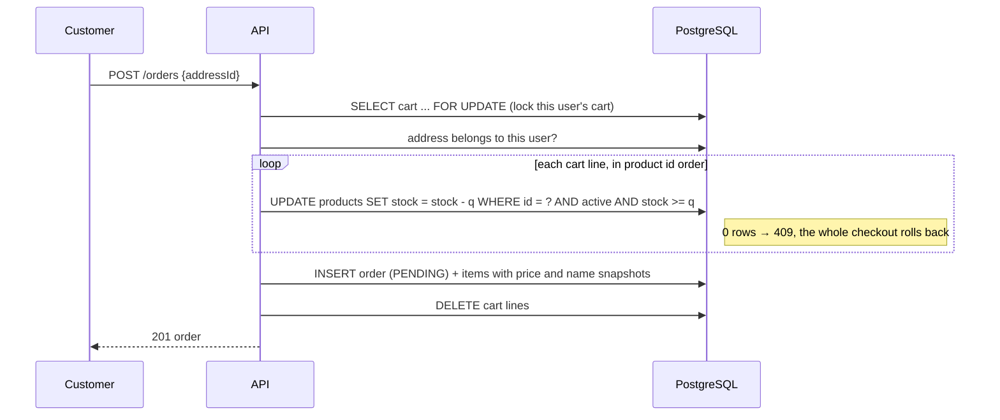
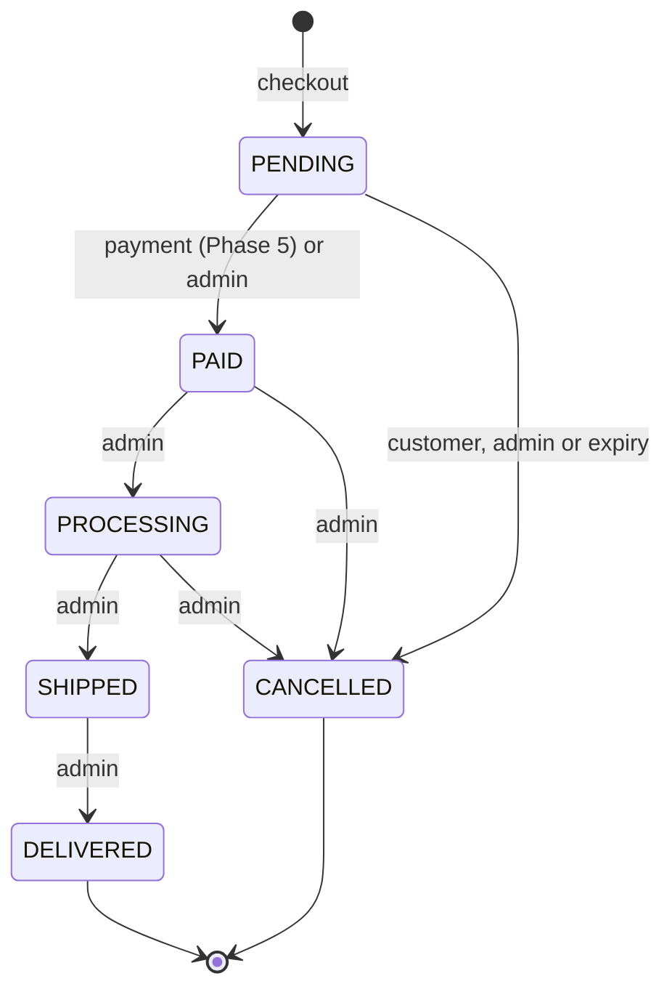

# Cart & Orders

Address book, shopping cart, checkout with stock reservation, order history, the order status flow, and expiry of unpaid orders.

- [Endpoints](#endpoints)
- [Checkout](#checkout)
- [Preventing overselling](#preventing-overselling)
- [Order snapshots](#order-snapshots)
- [Order status flow](#order-status-flow)
- [Expiring unpaid orders](#expiring-unpaid-orders)
- [Ownership checks](#ownership-checks)
- [Concurrency summary](#concurrency-summary)
- [Configuration](#configuration)
- [Try it locally](#try-it-locally)
- [Tests](#tests)

## Endpoints

All endpoints require a signed-in user. Customer endpoints always act on **the caller's own** data.

**Address book**: `/api/v1/users/me/addresses`

| Method | Path | Notes |
|---|---|---|
| `GET` | `/addresses` | My addresses |
| `POST` | `/addresses` | The first address is always the default |
| `PUT` | `/addresses/{id}` | `isDefault: true` moves the default here; it cannot be removed directly |
| `DELETE` | `/addresses/{id}` | Deleting the default promotes the oldest remaining address. Past orders are unaffected. |

**Cart**: `/api/v1/cart` (created automatically on first use)

| Method | Path | Notes |
|---|---|---|
| `GET` | `/cart` | Lines with **current** prices, subtotals and total |
| `POST` | `/cart/items` | `{productId, quantity}`; adding a product already in the cart increases its quantity |
| `PUT` | `/cart/items/{itemId}` | `{quantity}` |
| `DELETE` | `/cart/items/{itemId}` | Remove a line |
| `DELETE` | `/cart` | Empty the cart |

Quantities are limited to 99 per line and checked against stock when added. That check is a courtesy for the shopper; stock is only **reserved** at checkout.

**Orders (customer)**: `/api/v1/orders`

| Method | Path | Notes |
|---|---|---|
| `POST` | `/orders` | Checkout: `{"addressId": 1}`, returns `201` with a `PENDING` order |
| `GET` | `/orders` | My orders, newest first; sortable by `createdAt` or `totalAmount` |
| `GET` | `/orders/{id}` | My order (`404` if it is not mine) |
| `POST` | `/orders/{id}/cancel` | Only while `PENDING`; stock is put back |

**Orders (admin)**: `/api/v1/admin/orders`

| Method | Path | Notes |
|---|---|---|
| `GET` | `/admin/orders?status=PAID` | All orders, optional status filter, paginated |
| `GET` | `/admin/orders/{id}` | Any order |
| `PATCH` | `/admin/orders/{id}/status` | `{"status": "SHIPPED"}`; must follow the [status flow](#order-status-flow) |

## Checkout



- **The server calculates every price and total.** The request contains only an address id; quantities come from the cart and prices from the products at that moment.
- **The payment provider is chosen later** (Phase 5), so a failed card payment can be retried with another provider without a new order.

```java
@Transactional
public OrderResponse checkout(Long userId, CheckoutRequest request) {
    Cart cart = cartRepository.findByUserIdForUpdate(userId)
            .filter(found -> !found.getItems().isEmpty())
            .orElseThrow(() -> new BadRequestException("Your cart is empty"));
    Address address = addressRepository.findByIdAndUserId(request.addressId(), userId)
            .orElseThrow(() -> new ResourceNotFoundException("Address not found"));
    ...
    for (CartItem line : linesSortedByProductId) {
        reserve(line.getProduct(), line.getQuantity());     // atomic, see below
        order.addItem(/* name and price copied from the product */);
    }
    orderRepository.save(order);
    cart.getItems().clear();
}
```

## Preventing overselling

Two shoppers press **Buy** on the last unit at the same moment. A naive "read stock → check → write" lets both read `stock = 1`, both pass the check, and the shop sells two of one.

Instead, the check and the decrement are **one SQL statement**:

```java
@Modifying
@Query("""
        update Product p set p.stock = p.stock - :quantity
        where p.id = :id and p.active = true and p.stock >= :quantity""")
int reserveStock(@Param("id") Long id, @Param("quantity") int quantity);
```

PostgreSQL locks the row while updating it. The second request waits, re-checks `stock >= quantity` against the committed value, matches 0 rows, and its checkout fails with `409 Not enough stock` and rolls back completely.

| Problem | Solution |
|---|---|
| Two buyers, one unit | Conditional `UPDATE` (above) |
| Two checkouts waiting on each other's rows (deadlock) | Every transaction reserves and releases stock **in product id order** |
| Double-click on **Buy** creates two orders | The user's cart row is locked with `SELECT ... FOR UPDATE`; the second request waits, then finds the cart empty (`400`) |
| Cached product page shows old stock | Checkout and cancellation evict the affected products from Redis after commit |

`StockReservationIntegrationTest` runs this against the real database: **8 concurrent buyers, 3 in stock, exactly 3 succeed, stock ends at 0.**

## Order snapshots

An order is a historical record. Later changes elsewhere must never change what it shows.

| Data | Stored on the order as | Why |
|---|---|---|
| Price | `order_items.price_at_purchase` | Price changes must not change past totals |
| Product name | `order_items.product_name` | Renamed products keep their original name in history |
| Shipping address | `orders.shipping_*` (embedded `ShippingAddress` record) | Editing or deleting an address must not rewrite past orders |

Earlier, orders pointed to the `addresses` table; editing an address silently changed old orders and deleting one was impossible. Migration `V5` copied each order's address into the order and removed the link.

## Order status flow



The allowed moves live in one place:

```java
public boolean canMoveTo(OrderStatus next) {
    return switch (this) {
        case PENDING -> next == PAID || next == CANCELLED;
        case PAID -> next == PROCESSING || next == CANCELLED;
        case PROCESSING -> next == SHIPPED || next == CANCELLED;
        case SHIPPED -> next == DELIVERED;
        case DELIVERED, CANCELLED -> false;
    };
}
```

- Any other move, or a move to the current status, returns `409`.
- **Every cancellation puts the reserved stock back.**
- Customers can cancel only `PENDING` orders; a paid order needs a refund, so it goes through the admin.
- Admins can mark `PENDING` orders `PAID` by hand for offline payments such as cash on delivery.

## Expiring unpaid orders

Stock is reserved at checkout, so an abandoned checkout would hold stock forever. `OrderExpiryJob` runs every 60 seconds and cancels `PENDING` orders older than 30 minutes, putting their stock back.

- Each order is expired in **its own transaction** and re-checked first, so one failure never affects the others.
- If a payment confirms the order at the same moment, the [version check](#concurrency-summary) makes one of the two changes fail; the job logs it and skips that order.
- An index on `(status, created_at)` keeps the query fast as orders accumulate.

## Ownership checks

Every customer query includes the caller's user id:

```java
Optional<Order> findByIdAndUserId(Long id, Long userId);
```

Asking for someone else's order, cart line or address returns **404, exactly like an id that does not exist**. Returning `403` would confirm that the record exists; `404` reveals nothing. This prevents IDOR (Insecure Direct Object Reference), one of the most common API vulnerabilities.

The user id comes from the token, never from the request, via a small annotation:

```java
@GetMapping("/{id}")
public OrderResponse get(@CurrentUserId Long userId, @PathVariable Long id) {
    return orderService.getMyOrder(userId, id);
}
```

## Concurrency summary

| Scenario | Mechanism | Result |
|---|---|---|
| Two buyers, last unit | Conditional `UPDATE ... WHERE stock >= q` | One `201`, one `409` |
| Same user submits checkout twice | `SELECT ... FOR UPDATE` on the cart | One order, one `400 Your cart is empty` |
| Multi-product checkouts in parallel | Rows locked in product id order | No deadlocks |
| Two status changes on one order | `@Version` optimistic locking (`V8`) | The second fails with `409` instead of overwriting |
| Expiry job vs. payment | Same version check | One wins; the job skips the order |
| One default address per user | Partial unique index (`V6`) | Enforced by the database |
| One cart line per product | Unique index on `(cart_id, product_id)` (`V7`) | Enforced by the database |

## Known limitation

The admin product update (`PUT /api/v1/admin/products/{id}`) sets `stock` to an absolute value. If a sale happens while an admin has the edit form open, saving the form overwrites that sale's decrement. The usual fix is a separate "adjust stock by ±N" endpoint, planned after the MVP.

## Configuration

| Property | Default | Notes |
|---|---|---|
| `app.orders.payment-timeout` | `30m` | How long a `PENDING` order holds its stock |
| `app.orders.expiry-check-interval` | `60s` | How often the expiry job runs |

## Try it locally

1. Run the app with the `dev` profile and open Swagger UI.
2. Log in as `customer@example.com` / `Customer@123` and click **Authorize**.
3. `GET /api/v1/cart`: the seed cart has a mouse and two t-shirts.
4. `GET /api/v1/users/me/addresses` to find your address id, then `POST /api/v1/orders` with `{"addressId": 1}`.
5. `GET /api/v1/products/3`: the stock has dropped.
6. Log in as `admin@example.com` / `Admin@123` and move the order with `PATCH /api/v1/admin/orders/{id}/status`.
7. Leave a new order unpaid for 30 minutes (or set `app.orders.payment-timeout=1m`) and watch it become `CANCELLED`.

## Tests

| Test | Covers |
|---|---|
| `OrderStatusTest` | All 36 status combinations against the allowed flow |
| `AddressServiceTest` | First address is default, moving the default, limit of 10, ownership, promoting a new default on delete |
| `CartServiceTest` | Merging lines, stock and 99-per-line limits, archived products, ownership, cart created on first use |
| `OrderServiceTest` | Empty cart, foreign address, rollback on shortage, price/name/address snapshots, product-id ordering, cache eviction, ownership, cancel rules and restocking, every admin transition, expiry |
| `OrderExpiryJobTest` | Cut-off time, and one concurrently-modified order does not stop the others |
| `StockReservationIntegrationTest` | Real PostgreSQL: 8 concurrent buyers, 3 in stock, exactly 3 succeed |
| `OrderOptimisticLockingIntegrationTest` | Real PostgreSQL: a stale status change is rejected and the first change survives |

```bash
mvnw.cmd test
```

The two integration tests use the `dev` profile, so Docker Compose must be running.
