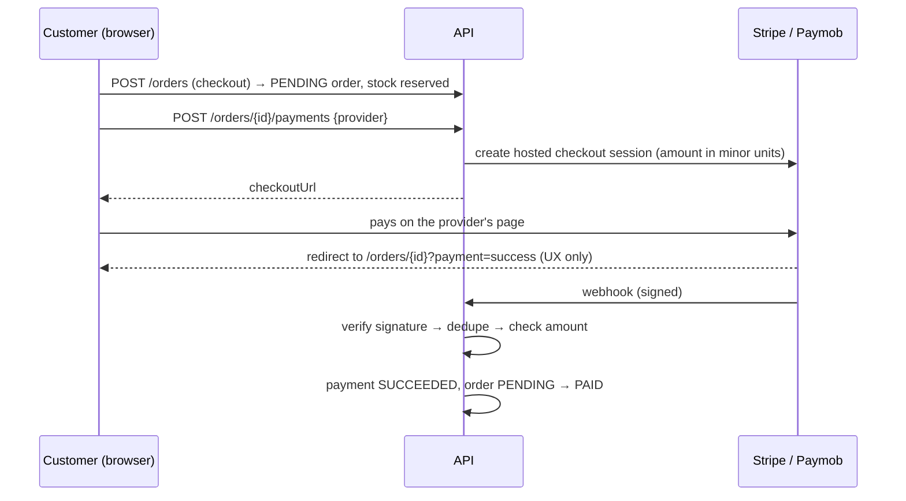

# Payments

Stripe and Paymob checkout with verified, idempotent webhooks. The store's country decides the currency and which providers are offered.

- [Principles](#principles)
- [Country, currency and providers](#country-currency-and-providers)
- [Endpoints](#endpoints)
- [Payment flow](#payment-flow)
- [Processing a webhook](#processing-a-webhook)
- [What happens when…](#what-happens-when)
- [Stripe](#stripe)
- [Paymob](#paymob)
- [Payments and order expiry](#payments-and-order-expiry)
- [Configuration](#configuration)
- [Trying it with real test accounts](#trying-it-with-real-test-accounts)
- [How it was tested](#how-it-was-tested)
- [Known limitations](#known-limitations)

## Principles

1. **We never handle card numbers.** Customers pay on the provider's hosted page (Stripe Checkout, Paymob Unified Checkout). This keeps the API out of PCI card-data scope.
2. **Only a signed webhook marks an order paid.** The browser's return to a "success" URL is just navigation; anyone can type that URL.
3. **Every webhook is authenticated by its signature**, not by a JWT: HMAC-SHA256 for Stripe (with a 5-minute replay window), HMAC-SHA512 for Paymob.
4. **Every webhook is applied at most once.** Providers retry and sometimes send duplicates.
5. **The paid amount and currency must equal the order total**, or the order is not marked paid.

## Country, currency and providers

One deployment serves one country, set with `STORE_COUNTRY` (ISO 3166). Everything else is derived:

| `STORE_COUNTRY` | Currency | Default provider |
|---|---|---|
| `EG`, `SA`, `AE`, `OM`, `PK` (Paymob markets) | EGP, SAR, AED, OMR, PKR | Paymob |
| `US` | USD | Stripe |
| `DE`, `FR`, `IT`, `ES`, … | EUR | Stripe |
| `GB` | GBP | Stripe |

- The currency comes from Java's built-in country table, so there is no list to maintain. Override with `APP_STORE_CURRENCY`.
- Providers can be overridden, e.g. both in the UAE: `APP_STORE_PAYMENTPROVIDERS=PAYMOB,STRIPE`.
- A provider is only **offered** when its credentials are configured.
- An invalid country or currency code stops the app at startup with a clear message.
- Product prices are in the store currency. Each order **snapshots** its currency, so changing the country later never changes past orders.
- Amounts are sent to providers in **minor units** using each currency's own decimals (JPY 0, EGP/USD 2, KWD 3), and money is never rounded silently.

`GET /api/v1/store` tells clients what to show:

```json
{ "country": "EG", "currency": "EGP", "timeZone": "Africa/Cairo", "paymentProviders": ["PAYMOB"] }
```

## Endpoints

| Method | Path | Auth | Notes |
|---|---|---|---|
| `GET` | `/api/v1/store` | Public | Country, currency, time zone, available providers |
| `POST` | `/api/v1/orders/{id}/payments` | Customer | `{"provider": "STRIPE"}` (optional; defaults to the store's first provider). Returns `{paymentId, provider, checkoutUrl, expiresAt}`. |
| `GET` | `/api/v1/orders/{id}/payments` | Customer | Payment attempts for my order |
| `POST` | `/api/v1/payments/webhooks/stripe` | Signature | Called by Stripe |
| `POST` | `/api/v1/payments/webhooks/paymob` | Signature (`?hmac=`) | Called by Paymob |

Starting a payment:
- requires the order to be **mine** (`404` otherwise) and **`PENDING`** (`409` otherwise)
- **reuses** a still-open session for the same provider instead of creating a new one
- when switching provider, **closes** the other open session (also at Stripe), so an order cannot be paid twice

## Payment flow



The frontend shows "processing" after the redirect and polls the order until it becomes `PAID`.

## Processing a webhook

```mermaid
flowchart TD
    A[POST /payments/webhooks/{provider}] --> B{Signature valid?}
    B -- no --> X[400, nothing changes]
    B -- yes --> C{Event type we act on?}
    C -- no --> OK[200]
    C -- yes --> D{"First time we see this event id?<br/>(INSERT … ON CONFLICT DO NOTHING)"}
    D -- no --> OK
    D -- yes --> E{Known session?}
    E -- no --> L[log warning, 200]
    E -- yes --> F{Amount and currency match?}
    F -- no --> G[payment FAILED + review note, order unchanged]
    F -- yes --> H{Order still PENDING?}
    H -- yes --> I[payment SUCCEEDED, order PAID]
    H -- no --> J[payment SUCCEEDED + 'refund required' note]
```

**Idempotency is enforced by the database**, so even two simultaneous deliveries of the same event cannot both be applied:

```java
@Modifying
@Query(value = """
        insert into processed_webhook_events (provider, event_id, received_at)
        values (:provider, :eventId, now())
        on conflict (provider, event_id) do nothing""", nativeQuery = true)
int markEventProcessed(@Param("provider") String provider, @Param("eventId") String eventId);
```

The marker is written in the same transaction as the payment update. If anything fails (for example an optimistic-lock conflict with the expiry job), both roll back, the endpoint returns an error, and the provider retries later.

**Response codes tell the provider what to do.** `200` means received, don't retry. `400` (bad signature, unreadable event) means don't retry. `5xx` means try again later.

## What happens when…

| Scenario | Result |
|---|---|
| Someone forges a webhook, or replays an old Stripe one | `400`; the order is unchanged |
| The same webhook arrives twice | Applied once; the second gets `200` and does nothing |
| `expired` arrives after `succeeded` (out of order) | Ignored; a payment never moves backwards |
| The paid amount or currency differs from the order total | Order stays `PENDING`; payment `FAILED` with a review note; logged as an error |
| The customer switches from Paymob to Stripe | The Paymob session is closed; only one payable session exists |
| The customer pays an old page anyway, or pays after the order was cancelled | The payment is recorded as `SUCCEEDED` with "refund required"; the order is unchanged; logged as an error. The money is never lost silently. |
| The customer cancels an order while a payment page is open | Open sessions are closed (expired at Stripe) |
| A Paymob transaction is still pending | Ignored until the final callback |
| A Stripe session completes with a delayed method (e.g. bank debit) | Waits for `async_payment_succeeded` or `async_payment_failed` |
| A provider is down when starting a payment | `502`, no payment created; the customer can retry |
| A provider has no credentials on this server | `503 … payments are not configured` |

## Stripe

- **SDK:** official `stripe-java` (34.x), with the `StripeClient` API and explicit 10 s connect / 20 s read timeouts.
- **Checkout Session:** one line item per order item, the customer's email, `orderId` and `paymentId` metadata, and `expires_at` = now + 31 minutes (Stripe requires at least 30).
- **Idempotency key** `payment-{id}` on session creation, so a retried request returns the first session instead of creating another.
- **Events handled:**

  | Event | Effect |
  |---|---|
  | `checkout.session.completed` (when `payment_status = paid`) | SUCCEEDED |
  | `checkout.session.async_payment_succeeded` | SUCCEEDED |
  | `checkout.session.async_payment_failed` | FAILED |
  | `checkout.session.expired` | EXPIRED |

- Events from older Stripe API versions are still parsed. A validly signed but unreadable event returns `400`, so Stripe doesn't retry it forever.

## Paymob

- **No official Java SDK**, so the gateway uses Spring's `RestClient` with the **Intention API** (Unified Checkout): `POST /v1/intention/` returns a `client_secret`, and the customer is sent to `/unifiedcheckout/?publicKey=…&clientSecret=…`.
- The whole order is sent as **one line item**, because Paymob rejects intentions whose item amounts don't add up exactly.
- Billing fields we don't collect (phone, building, floor, apartment) are sent as `NA`, as Paymob requires every field.
- **Callback verification:** HMAC-SHA512 over the values of Paymob's documented fields, in this order, compared in constant time:

  ```
  amount_cents, created_at, currency, error_occured, has_parent_transaction, id, integration_id,
  is_3d_secure, is_auth, is_capture, is_refunded, is_standalone_payment, is_voided, order.id,
  owner, pending, source_data.pan, source_data.sub_type, source_data.type, success
  ```

- **HTTP/1.1** is forced for Paymob calls. The JDK client's default HTTP/2 upgrade attempt failed behind Docker's port relay during testing (`EOF reached while reading`).

## Payments and order expiry

Stock is reserved at checkout and released if the order isn't paid in time ([Cart & Orders](orders.md#expiring-unpaid-orders)). Payments add two rules:

- **The expiry job never cancels an order while its payment page is open.** It skips orders that have an unexpired `PENDING` session, so a customer typing their card number never loses their order. The longest stock can be held is the payment window plus one session (about 1 hour).
- **Cancelling an order closes its open payment sessions**, so a cancelled order can't be paid.

## Configuration

Set these as environment variables (for example in the IntelliJ run configuration). **Never commit real keys.**

| Variable | Example | Notes |
|---|---|---|
| `STORE_COUNTRY` | `EG` | Required; default `EG` |
| `APP_STORE_CURRENCY` | `USD` | Optional override |
| `APP_STORE_PAYMENTPROVIDERS` | `PAYMOB,STRIPE` | Optional override |
| `STORE_TIME_ZONE` | `Africa/Cairo` | Days in [admin reports](stats.md); IANA id, default `Africa/Cairo` |
| `FRONTEND_URL` | `http://localhost:4200` | Customers return to `{FRONTEND_URL}/orders/{id}?payment=success` |
| `STRIPE_SECRET_KEY` | `sk_test_…` | Stripe is offered only when this and the next one are set |
| `STRIPE_WEBHOOK_SECRET` | `whsec_…` | From the Stripe dashboard or `stripe listen` |
| `STRIPE_API_BASE` | `http://localhost:12111` | Only for `stripe-mock`; leave empty for real Stripe |
| `PAYMOB_SECRET_KEY` / `PAYMOB_PUBLIC_KEY` | `egy_sk_test_…` / `egy_pk_test_…` | Paymob dashboard → Settings |
| `PAYMOB_HMAC_SECRET` | | Paymob dashboard |
| `PAYMOB_INTEGRATION_IDS` | `4567` | Comma-separated payment integration ids |
| `PAYMOB_NOTIFICATION_URL` | `https://api.example.com/api/v1/payments/webhooks/paymob` | Must be reachable from the internet |
| `PAYMOB_BASE_URL` | `https://accept.paymob.com` | Default |

`app.payments.session-ttl` (default `31m`) controls how long a payment page stays open.

## Trying it with real test accounts

**Stripe (free, test mode, no business verification needed):**

1. Create an account at <https://dashboard.stripe.com/register> and stay in **Test mode**.
2. Copy the **secret key** (`sk_test_…`) from *Developers → API keys*.
3. Install the [Stripe CLI](https://docs.stripe.com/stripe-cli), then run:
   ```bash
   stripe login
   ```
   ```bash
   stripe listen --forward-to localhost:3330/api/v1/payments/webhooks/stripe
   ```
   It prints a webhook secret (`whsec_…`) and forwards Stripe's webhooks to your local app.
4. In the IntelliJ run configuration, set `STORE_COUNTRY=US` (or keep `EG` and set `APP_STORE_PAYMENTPROVIDERS=STRIPE`), `STRIPE_SECRET_KEY` and `STRIPE_WEBHOOK_SECRET`, then run with the `dev` profile.
5. Check out an order, call `POST /api/v1/orders/{id}/payments`, and open the `checkoutUrl`.
6. Pay with test card `4242 4242 4242 4242`, any future expiry and any CVC. The order becomes `PAID` within seconds.

**Paymob:** sign up at <https://accept.paymob.com>, use the test integration in the dashboard, and set the six `PAYMOB_*` variables. Paymob must reach your webhook over the internet, so expose port 3330 with a tunnel such as ngrok or Cloudflare Tunnel and use that URL for `PAYMOB_NOTIFICATION_URL`.

## How it was tested

**Unit tests:**

| Test | Covers |
|---|---|
| `StoreSettingsTest` | Country → currency/provider mapping for EG, SA, AE, US, DE, FR, GB; overrides; invalid codes |
| `MoneyTest` | Minor units for EGP, USD, JPY (0 decimals), KWD (3 decimals); no silent rounding |
| `PaymentServiceTest` | Session creation and reuse, closing the other provider's session, ownership, unavailable providers, duplicates, amount/currency mismatch, late and out-of-order events, closing sessions on cancel |
| `StripeGatewayTest` | Real Stripe signature scheme: valid, tampered, wrong secret, 10-minute-old, missing header; paid/unpaid/expired/irrelevant events; older API versions; unreadable events |
| `PaymobGatewayTest` | Intention request body checked with `MockRestServiceServer`; checkout URL; provider outage → 502; HMAC with the expected value written out by hand in Paymob's field order; tampering; pending, declined and non-transaction callbacks |
| `OrderExpiryQueryIntegrationTest` | Real PostgreSQL: abandoned, actively paying, expired-session and recent orders |

**Offline end-to-end run (31 checks)** against the running app, a throwaway database, Stripe's official [`stripe-mock`](https://github.com/stripe/stripe-mock) server and a WireMock stand-in for Paymob. Webhooks were signed with `openssl` using each provider's real scheme. It covers every row of [What happens when…](#what-happens-when).

## Known limitations

- **No automatic refunds.** Payments flagged "refund required" are logged and refunded from the provider dashboard. An admin view of flagged payments comes with the admin statistics phase.
- **Paymob intentions can't be cancelled remotely.** A late Paymob payment is caught by the order checks and flagged for refund.
- **One currency per store.** Showing each visitor prices in their own currency would need live exchange rates and is out of the MVP's scope.
- Prices are stored with 2 decimals, so 3-decimal currencies (KWD, OMR, BHD) can't express amounts below 0.01.
